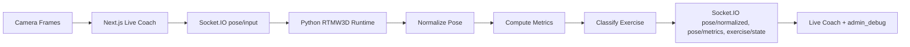
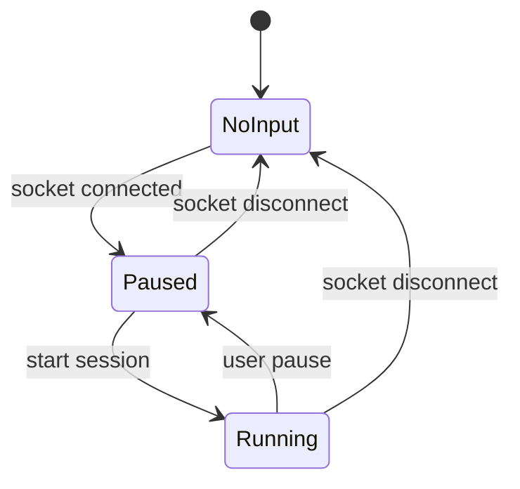

# 01-architecture.md

## Scope
- Two pages only: / (Live Coach) and /admin_debug (Debug)
- Five exercises: squat, push_up, jumping_jack (full body in frame) and bicep_curl, lateral_raise (one arm in frame is enough), picked in the UI and sent with each frame
- Backend required: Python + Socket.IO with RTMW3D-L inference

## Runtime Flow

## Session State

## Key Modules
- frontend: `workspace/frontend`
- backend: `workspace/backend/app`
- docs: `docs/*.md`

## Pose Contract
- PoseFrame: { t, space, joints[] }
- joints[]: { name, x, y, z, c }
- space: camera | normalized

## Notes
- Only RTMW3D-L is the default model size.
- GPU is preferred, CPU fallback is allowed.
